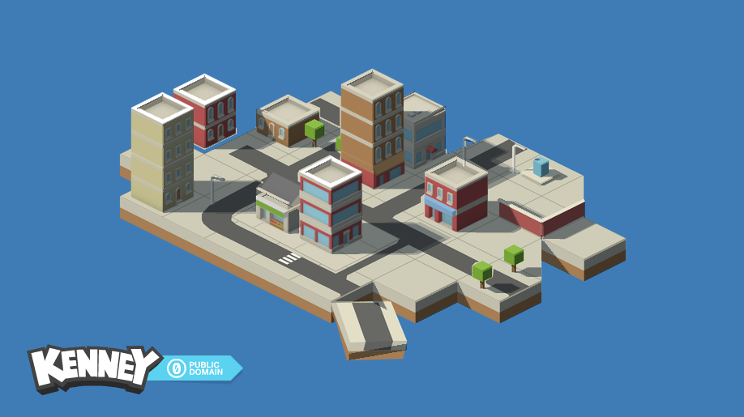

# Isometric Light

A local Three.js reconstruction of `sample.png` with a movable global sun and screen-space raymarched shadows. The artwork is composed from the supplied building sprites and independently drawn terrain, roads, trees, lamps, terrace and ramp. Blender 5.2 supplies real closed geometry and four layers of front/back depth intervals.



## Run

Node.js 22 was used for development. The generated assets are included; Blender and Python are **not required to run the demo**.

```powershell
npm ci
npm run dev
```

Open the local URL printed by Vite. Use the direction/elevation sliders, shadow softness/strength, animation switch and shadow toggle. The five views expose the scene, linear depth, solid thickness, normals and shadow mask. The reference comparison slider and PNG export are functional. Keyboard: **Space** animates the sun; **S** toggles shadows when a form control is not focused.

For a production bundle:

```powershell
npm run build
npm run preview
```

The build copies the precise float buffers and scene textures into `dist/`. Serve that directory over HTTP; opening `index.html` through `file://` cannot load the buffers.

## Rebuild the artwork and Blender data

The scripts resolve their inputs relative to the project root. Python 3.11, Pillow 13.0 and NumPy 2.4 were used; Blender includes its own Python/NumPy.

```powershell
python -m pip install -r requirements.txt
python scripts/compose_scene.py
& 'C:\Program Files\Blender Foundation\Blender 5.2\blender.exe' --background --python-exit-code 1 --python scripts/reconstruct_blender.py
python scripts/analyze_assets.py
```

`generated/scene-layout.json` contains the measured placements: 21 sprites from 16 unique source images, at scale `26/33`. `scripts/analyze_assets.py --match` reruns the masked FFT sprite matching as supporting evidence; the checked-in layout also contains manually verified stacking and prop positions.

`generated/reconstructed-scene.blend` is an editable Blender 5.2.2 project with the scene, orthographic camera and a hidden collection of reusable low-poly geometry for all 129 supplied assets. Facade details remain in the source sprites; these meshes reconstruct the solid volumes needed for shadows. The terrain and props are shared between the artwork composition and the bake. Evaluated Blender triangles are rasterized numerically to avoid color-management changes to depth data.

## Rendering

1. `compose_scene.py` builds the static albedo from original PNGs, with geometric alpha clipping of their tile bases, appropriate building ordering and vector scenery. Only the isolated Kenney credit mark is cropped from the reference; no reference scene pixels are used in the reconstruction texture.
2. `reconstruct_blender.py` exports four disjoint occupied intervals per camera ray, plus visible normals, materials and validity. Connected/overlapping intervals merge; separated objects retain their air gaps. Raw float32 data are the rendering inputs. PNGs are diagnostic previews.
3. Three.js uploads the intervals as an RGBA32F `DataArrayTexture`. The nearest front plus its pixel coordinate reconstructs a receiver. An exact grid DDA visits every screen texel crossed toward the directional sun and tests its ray entry/exit segment against all four occupied intervals.
4. One ray gives hard shadows; three fixed angular samples approximate a finite sun. A second full-screen pass combines visibility with the original pre-lit artwork. Shadows render only on demand, or at up to 20 updates per second during animation. Animation time is independent of display refresh rate.

Both rendering passes use Three.js/WebGL2 shader materials; the displayed scene has no baked cast-shadow texture. The sun changes shadow visibility throughout the town. The camera remains fixed to preserve the reference composition.

See [the research and implementation audit](docs/SHADOW_RESEARCH.md) for primary sources, depth/thickness equations, DDA reasoning, bias, hidden surfaces, softness and alternatives. See [the Blender buffer contract](generated/BLENDER_PIPELINE.md) for binary packing and camera conventions.

## Verification

With either the dev server or production preview running:

```powershell
npm test
python scripts/verify_buffers.py
```

The browser test uses installed Chrome on Windows. Set `CHROME_PATH` to another Chromium executable if needed. To test production instead of the default dev URL:

```powershell
$env:TEST_URL = 'http://127.0.0.1:4173'
npm test
```

Evidence is in `verification/`: desktop/mobile screenshots, reference split comparison, hard/soft masks, alternate sun positions, exported PNG, browser report, buffer report and a reference/reconstruction/difference triptych. `generated/` contains actual Blender and numerical geometry previews, depth front/back, thickness, normal, material, validity and silhouette-difference images.

Checks cover buffer size/finiteness, ordered disjoint front/back intervals, unit normals, real rendered changes from shadow/light controls, all debug views, animation, reset, reference comparison, downloads, mobile overflow and browser/shader errors. Numerical comparisons distinguish the large uniform blue background from the actual foreground, and exclude the artist credit from the foreground comparison.

## Accuracy and limits

The static composition has RGB mean absolute error **4.20/255 over the complete image** and about **14.55/255 over the reference scene foreground**. Full-image error benefits from the large matching blue background. The final proxy/art silhouette intersection-over-union is **98.49%**; this measures silhouette alignment, not shadow accuracy. Source lighting, ground gradients, seams and small decorations are approximate.

The final bake has 133,204 visible valid pixels. At 328 pixels (about 0.246%) more than four disconnected occupied intervals exist; deeper intervals are omitted. The fixed camera cannot recover unmodeled/offscreen geometry. Small roof details can retain raster stair steps, three light samples can produce discrete penumbra bands, and the art-preserving color composite is intentionally artistic rather than physically linear lighting. These limits are exposed in the research and QA records.

## Credits

Building artwork: [Kenney, Isometric Tiles Buildings](https://kenney.nl/assets/isometric-tiles-buildings), listed by its author under CC0. The original `sample.png` and assets were provided with this task. The isolated credit mark is preserved from that sample. The UI optionally requests DM Sans and Manrope from Google Fonts and falls back to local sans-serif fonts when unavailable.
